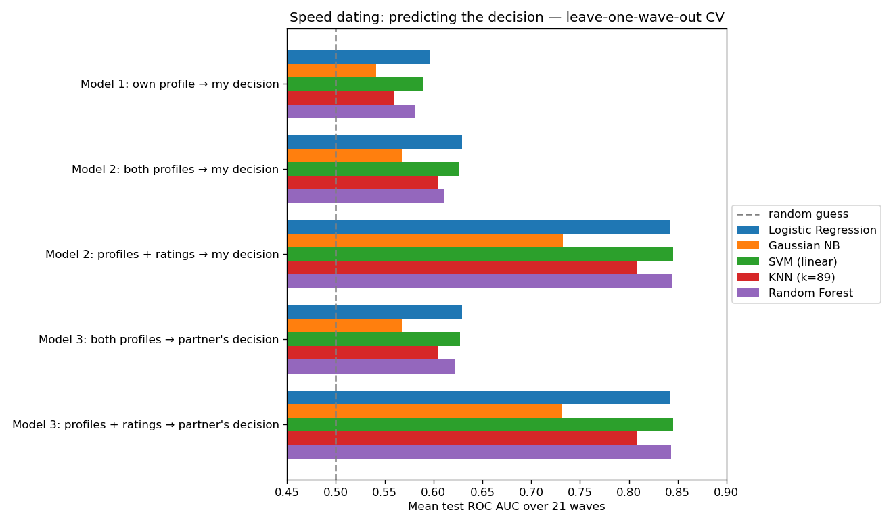

# Speed Dating Experiment
*Final project · Technion Certified Data Scientist · [Technion – Israel Institute of Technology](https://www.technion.ac.il/), School of Continuing Education · 2024*

Exploratory data analysis and classical machine learning on the Speed Dating dataset: data cleaning
(answers given on two different rating scales), feature engineering, and binary classification of dating
decisions with five scikit-learn models evaluated by leave-one-wave-out cross-validation.<br/>
**Language:** Python 3.10. **Libraries:** pandas, NumPy, scikit-learn, Matplotlib, Jupyter.<br/>
**Installation:** `pip install -r requirements.txt`.<br/>
**Data:** [Speed Dating Experiment](https://www.kaggle.com/datasets/annavictoria/speed-dating-experiment) (Kaggle),
included in [data/](data/) with its description [speed_dating_key.doc](data/speed_dating_key.doc).<br/>



---

## Dataset

Data was gathered from participants of experimental speed-dating events in 2002–2004. Every attendee had a
four-minute "first date" with every participant of the opposite sex. At the end of the four minutes they
were asked whether they would like to see their date again, and rated the date on six attributes:
attractiveness, sincerity, intelligence, fun, ambition and shared interests. Before the event every
participant filled in a questionnaire: demographics, dating habits, interests, what they look for in a
partner and how they rate themselves.

**8,378 dates · 551 participants · 21 events (waves) · 195 columns.** One row is one date seen from one
participant, so every date appears twice — once from each side.

## Notebooks

| Notebook | Contents |
|---|---|
| [01_eda.ipynb](notebooks/01_eda.ipynb) | Meta analysis, the participants, stated preferences by gender, self-image vs. how partners see a person, effects of the event set-up, correlations of the features with the decisions |
| [02_model_own_profile.ipynb](notebooks/02_model_own_profile.ipynb) | Model 1: predicting my decision from my own sign-up profile |
| [03_model_decisions.ipynb](notebooks/03_model_decisions.ipynb) | Models 2 and 3: predicting my decision and the partner's decision from both profiles, with and without the scorecards of the date |
| [04_results.ipynb](notebooks/04_results.ipynb) | Comparison of all models, hard waves, special event conditions |

Shared code is in [src/speed_dating](src/speed_dating): data loading and cleaning, feature sets, evaluation.

## Data cleaning

* The "what is important" questions split 100 points between six attributes, but some waves answered on a
  1–10 scale per attribute instead, and some answers sum to 80–148 instead of 100. Every answer is checked
  by its sum and rescaled to shares of 100.
* Questions about people (age, race, preferences) are counted per participant, questions about dates on
  all rows; pairs (match rates) are counted once per date.
* Columns from the follow-up questionnaires (`*_2`, `*_3`) are missing for most participants and are not
  used.

## Method

* **Targets:** `dec` (my decision about the partner) and `dec_o` (the partner's decision about me).
* **Feature sets:**
  * *own profile* — my sign-up questionnaire only;
  * *both profiles* — my and the partner's questionnaires: everything known **before** the date;
  * *profiles + ratings* — plus both scorecards of the date (attributes, "how much do you like the
    partner", "how probable is it that the partner says yes"), filled in **after** the date.
* **Models:** logistic regression, Gaussian Naive Bayes, linear SVM, KNN, random forest, and a
  majority-class baseline.
* **Evaluation:** leave-one-wave-out cross-validation — train on 20 events, test on the 21st, for each
  event. No participant is in both the training and the test data. One-hot encoding and scaling are fitted
  inside every fold (scikit-learn `Pipeline` + `ColumnTransformer`). Metrics: accuracy, F1, ROC AUC.

## Results

Best model of every configuration, mean over the 21 test waves:

| Configuration | Baseline accuracy | Best model | Accuracy | F1 | ROC AUC |
|---|---|---|---|---|---|
| Model 1: own profile → my decision | 0.560 | Logistic Regression | 0.581 | 0.428 | 0.596 |
| Model 2: both profiles → my decision | 0.562 | Logistic Regression | 0.600 | 0.487 | 0.629 |
| Model 2: profiles + ratings → my decision | 0.551 | Linear SVM | **0.769** | **0.740** | **0.845** |
| Model 3: both profiles → partner's decision | 0.562 | Logistic Regression | 0.600 | 0.487 | 0.629 |
| Model 3: profiles + ratings → partner's decision | 0.551 | Linear SVM | **0.771** | **0.742** | **0.845** |

Logistic regression and random forest are within 0.01 of the linear SVM; Gaussian Naive Bayes is the
weakest model everywhere.

## Findings

* **People say one thing and decide by another.** Women give attractiveness only 18 of 100 points and
  put intelligence first; men give attractiveness 27 points. But the decision correlates most with "how
  much did I like the partner" (r = 0.51), attractiveness (0.49), fun (0.41) and shared interests (0.40),
  and much less with sincerity, intelligence and ambition (0.18–0.22).
* **Everyone thinks others care more about looks.** Women believe men give attractiveness 36 points; men
  say 27.
* **People rate themselves higher than their partners do**, on every attribute, and expect others to see
  them the same way they see themselves.
* **Questionnaires do not predict attraction.** Before the date the best model is barely better than a
  random guess (ROC AUC 0.63). After four minutes together the two scorecards predict the decision well
  (77% accuracy, ROC AUC 0.84).
* **Same race hardly matters** (match rate 17.1% vs. 16.0%); a small **age difference** does (about 20%
  for the same age, 10% for 8+ years).
* **The first date of the night** has the highest match rate (23%); there is no "lucky table".
* **Models 2 and 3 coincide by construction:** every date is stored from both sides, so predicting the
  partner's decision is the same task on the mirrored rows.

## Project structure

```
data/                 dataset (CSV) and its description
notebooks/            01–04: EDA, models, results
src/speed_dating/     data.py, features.py, evaluation.py
results/              per-wave scores of every model (CSV), summary, figures
```

## License

The code in this repository is licensed under the [MIT License](LICENSE).
The dataset in [data/](data/) is not covered by this license: it is the
[Speed Dating Experiment](https://www.kaggle.com/datasets/annavictoria/speed-dating-experiment) dataset from Kaggle.
